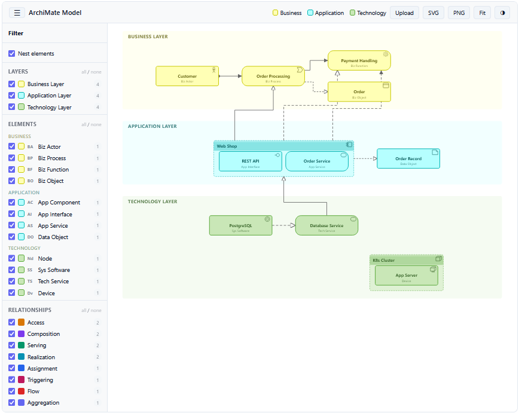

<picture>
  <source media="(max-width: 556px) and (prefers-color-scheme: dark), (min-width: 768px) and (max-width: 844px) and (prefers-color-scheme: dark)" srcset="https://raw.githubusercontent.com/StevenBtw/anywidget-archimate/main/.github/readme/header-narrow-dark.svg">
  <source media="(max-width: 556px), (min-width: 768px) and (max-width: 844px)" srcset="https://raw.githubusercontent.com/StevenBtw/anywidget-archimate/main/.github/readme/header-narrow-light.svg">
  <source media="(prefers-color-scheme: dark)" srcset="https://raw.githubusercontent.com/StevenBtw/anywidget-archimate/main/.github/readme/header-dark.svg">
  
</picture>

Renders ArchiMate models from Open Exchange Format XML or Archi `.archimate` files, or from Python data, in layer bands from top to bottom:

- **Lilac:** Motivation
- **Tan:** Strategy
- **Yellow:** Business
- **Blue:** Application
- **Green:** Technology, including the Physical elements
- **Pink:** Implementation & Migration
- **Grey:** Other (Location, Grouping, and any other layer)

A band only appears when the model has elements in it. Every ArchiMate 3.2 element type is drawn with its notation icon, junctions as small dots (filled for And, hollow for Or) in the band of the elements they join, and all 11 relationship types with their notation.

The diagram is laid out as a layered view: Business, Application and Technology each split into labelled bands by role (actors and roles, business services, business processes and objects; application services and interfaces, applications and data; technology services, infrastructure), with elements in columns and relationship lines running in the gaps between them, never through an element. Within a layer, elements joined by Composition, Aggregation, Assignment or Realization are nested, so that line disappears; a container keeps its own services and interfaces on its top row. Elements are drawn as a ring in their layer's colour over a light fill of it, in the look the anywidgets share.

<picture>
  <source media="(prefers-color-scheme: dark)" srcset="https://raw.githubusercontent.com/StevenBtw/anywidget-archimate/main/assets/archimate-dark.png">
  <source media="(prefers-color-scheme: light)" srcset="https://raw.githubusercontent.com/StevenBtw/anywidget-archimate/main/assets/archimate-light.png">
  
</picture>

## Install

```bash
uv add anywidget-archimate
```

## Usage

```python
from anywidget_archimate import ArchiMate

# From an XML file
widget = ArchiMate.from_xml("model.xml")
widget
```

```python
# Or load later
widget = ArchiMate()
widget.load_xml("model.xml")
```

### From Python data

```python
widget = ArchiMate(
    elements=[
        {"id": "a1", "name": "Web shop", "type": "ApplicationComponent", "layer": "Application", "documentation": ""},
        {"id": "t1", "name": "App server", "type": "Node", "layer": "Technology", "documentation": ""},
    ],
    relationships=[
        {"id": "r1", "source": "t1", "target": "a1", "type": "Serving", "name": ""},
    ],
    height=500,
)
```

- `layer` is `Motivation`, `Strategy`, `Business`, `Application`, `Technology`, `Implementation` or `Other`, in any case; `Implementation & Migration` and `Physical` (Technology) work too. Without a layer, or with one the widget does not know, the element goes to the layer of its type, else to Other.
- `type` is an ArchiMate 3.2 element type such as `BusinessProcess`, `Capability`, `Goal` or `WorkPackage`; a junction is `AndJunction` or `OrJunction`. Other types draw as a plain box.
- Relationship `type` is one of `Composition`, `Aggregation`, `Assignment`, `Realization`, `Serving`, `Access`, `Influence`, `Triggering`, `Flow`, `Specialization` or `Association`.
- Names, documentation and the other values are shown as text, never as HTML.
- `height` sets the diagram's height in pixels. Left at 0 (the default), the widget fills the cell's width at 16:10, at least 360px and at most 80% of the screen high.

### Selection and highlights

Clicking an element sets `selected_element` to its dict and opens its details beside the diagram (`show_details=False` keeps them closed, for a host that shows the selection itself). The host can also select or outline elements:

```python
widget.selected_element = {"id": "a1"}  # a dict with at least the id
widget.highlight_ids = ["a1", "t1"]  # outline several elements
widget.observe(lambda change: print(change["new"]), names="selected_element")
```

### Comparison styling

To show several runs of one model, give elements and relationships an optional `status`:

| `status` | Element | Relationship |
| --- | --- | --- |
| `partial` | dashed and faded | faded |
| `changed` | amber fill | amber line |
| `only_a` | red fill | red line |
| `only_b` | green fill | green line |
| `ghost` | very faint and dashed | very faint |

`stable` or no status draws as usual. An optional `badge` on an element (for example `"2/3"`) is drawn in its top left corner; text longer than 26 characters is cut.

### Reading a large model

- **Quiet lines**: relationship lines are drawn faint until you point at or select an element; then its lines, and those of the elements inside it, show at full strength. Exports draw every line in full.
- **Folding**: the "−" on a container's header folds it into one box (it shows how many elements it holds) and its relationships attach to the box; "+" unfolds it.
- **Nest relationships**: a relationship that more than half of a container's children share, with the same type and the same element at the other end, is drawn once at the container. Point at it to see the elements it stands for; its tooltip lists the relationships.
- **Opening view**: a model too large to read when fitted opens at a readable size from the top; the fit button shows the whole model.

### Toolbar

The toolbar opens the filter panel (hide layers, element types and relationship types; turn off "Nest elements" or "Nest relationships"), opens an `.xml` or `.archimate` file, exports the diagram as SVG or PNG (one menu), fits the diagram to the view and switches between light and dark. The filter panel starts open when the widget is 900px or wider. The theme follows the host page (marimo, Jupyter, VS Code, or the operating system) unless you choose one: pass `dark_mode=True` or `dark_mode=False`, set `widget.dark_mode`, or use the toolbar switch.

## Development

```bash
git clone https://github.com/StevenBtw/anywidget-archimate.git
cd anywidget-archimate
uv sync
uv run pytest
```

The `examples/demo_marimo.py` example needs marimo, which is an optional extra:

```bash
uv sync --extra examples
```

## License

Apache-2.0
